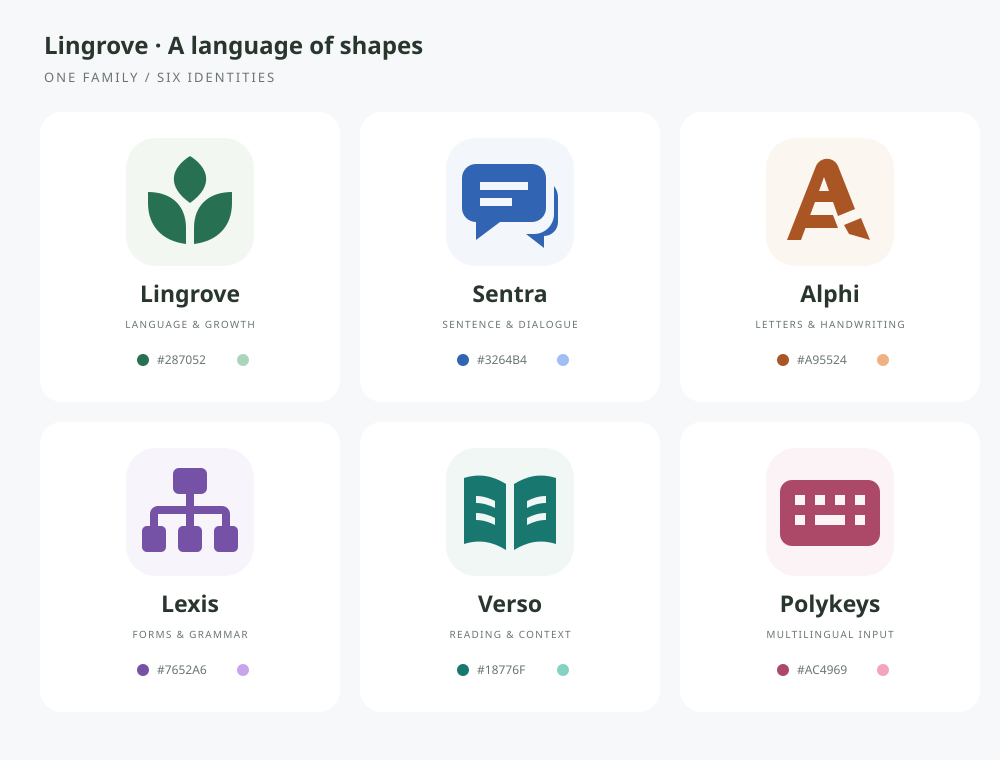

# Lingrove 图标与主题

所有标志使用同一套 128 × 128 几何网格：单色实心轮廓、负形细节、无渐变、无阴影。图形独立于文字与字体，小尺寸也能辨认。主题的浅色与暗黑版本共享色相，按钮文字、画布、卡片、分隔线、焦点及选中背景一起适配。

| 应用 | 图形含义 | 浅色强调色 | 暗黑强调色 | 矢量源文件 |
| --- | --- | --- | --- | --- |
| Lingrove | 三片叶子组成展开的书，寓意语言学习与成长 | `#287052` | `#AAD5BC` | [Logo.svg](../ios/Lingrove/Resources/Assets.xcassets/Logo.imageset/Logo.svg) |
| Sentra | 对话与句子，气泡中以负形留出两行文字 | `#3264B4` | `#9FBEF4` | [logo.svg](../app/sentra/public/logo.svg) |
| Alphi | 字母 A，右下笔画化为书写笔尖 | `#A95524` | `#F0B283` | [logo.svg](../app/omniglyph/public/logo.svg) |
| Lexis | 语法树，从词类分支到不同词形 | `#7652A6` | `#C6A5ED` | [logo.svg](../app/lexis/public/logo.svg) |
| Verso | 展开的书，负形文字与中缝 | `#18776F` | `#87D1C4` | [logo.svg](../app/verso/public/logo.svg) |
| Polykeys | 多语言输入键盘与空格键 | `#AC4969` | `#F0A4BF` | [logo.svg](../app/polykeys/public/logo.svg) |

子应用的 `public/logo.svg` 为透明背景的矢量原稿，`public/logo.png` 是同一图形的 512 × 512 浅色底导出，用于宿主应用列表、播放封面与浏览器触摸图标。浏览器 favicon 使用 SVG。`npm run build` 将两个文件一起打包，宿主继续读取 `logo.png`。

宿主首页使用 `Logo.imageset` 的模板矢量图，随宿主强调色变化；AppIcon 使用同一原稿导出的 1024 × 1024 不透明 PNG，分别提供浅色与暗黑版本。导出 PNG 时直接栅格化 SVG，使用对应主题的浅底或暗底，不添加渐变、阴影或预制圆角；应用列表与系统负责裁切圆角。

配色定义位于各应用 `src/style.css`。错误、警告与成功提示保留语义色。Alphi 的位图笔迹只调整显示颜色，评分仍读取原有 alpha 蒙版；PencilKit 使用相同的橙色浅色/暗黑笔墨。
